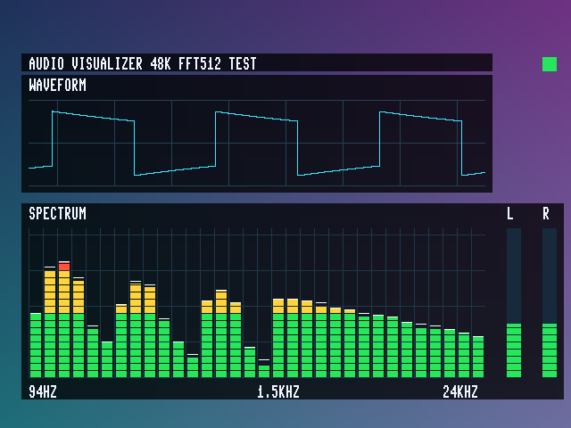

# 音频可视化：512 点 FFT / 1001（2026-10-29）

**用户已确认上板显示成功、板子测试无问题，记为功能 BOARD PASS。** 本版基于本地 `zoom_animation_video`，复用原图片、动画和 HDMI 音频链路。

## 使用与效果

- 按 K1 复位，SW4..SW1 设为 **1001**，显示青色波形、32 根频谱柱、白色峰值保持和 L/R 电平；拨回 `0000` 退出。开关在帧边界生效。
- 当前音源是原有内部 I2S 方波音阶，音符约每半秒变化，频谱包含基频和谐波；尚未新增外部音乐输入。左右音量基本一致属于预期。
- K2 切图、K4 轮播及原缩放/转场操作沿用；1001 原诊断图案被本页取代，1010～1111 诊断页保留。
- 右上状态块：灰色采集、绿色 FFT 已完成、红色输入 FIFO 曾溢出。正常测试未发生溢出。



图片是 RTL 仿真生成的 640×480 画面，背景为测试图，不是板端截图。实际板端使用原 TF 图片。

## 实现与验证

全部新增逻辑位于现有 25 MHz video_clk 域。左右 24 位 PCM 平均、IIR 去直流，转为 16 位后使用周期 Hann 窗和 radix-2 DIT FFT；一套 16×16 乘法器分时执行窗乘和复数乘法，每级右移一位并饱和。256 点输入 FIFO 保持采样连续；频谱目标、波形快照双缓冲，在消隐期更新显示。

前 16 柱对应 bin 1～16，其后频带逐渐加宽；取每带最大近似幅度，再做对数压缩。DC 和 Nyquist 单点不显示。名义采样率 48 kHz、频率间隔约 93.75 Hz；近似幅度不是校准的 dB/SPL。

RGB、DE、HS、VS、X/Y 在开启及旁路模式统一增加三拍，后续既有 AXIS 适配器再加一拍。为了修复集成后的 125 MHz 时序瓶颈，缓存行签名及行号先寄存、下一拍更新诊断结果；新增一拍只作用于观察信息，不影响像素、命令、仲裁或动画接口。

| 检查 | 结果 |
|---|---|
| 8 组 FFT、2048 个复数频点 | 与整数参考逐项一致；浮点参考最大误差 9 LSB，允许 12 LSB |
| 音频功能 | 10 帧频带目标对照、左右电平、反相抵消、静音衰减、复位通过 |
| 连续采样 | FIFO 最大占用 76/256；主动过载置位与复位清除通过 |
| 视频集成 | 8 帧、2457600 像素、8 SOF、3840 EOL，旁路及柱/峰值/波形逐像素对齐通过 |
| 行签名 | 正确行、错误行、首错保持、计数饱和、取消旧检查、复位通过 |
| 缓存回归 | 4 次上传、10 行读出、1024×1024 最大图、尾包、跨列及复位重载通过 |
| 实现时序 | setup +0.101 ns，hold +0.012 ns，两项 TNS=0，STA 覆盖率 95.18% |
| 资源 | LUT 14460/19600；REG 9449/19600；BRAM9K 48/64；DSP 23/29；PLL 3/4 |
| 板测 | 2026-10-29 用户确认显示成功、测试无问题 |

继承的 SDRAM 相关时钟例外没有修改；上述时序通过不代表被屏蔽接口完整电气时序闭合。用户反馈关联本聊天最新发布文件，没有独立测量板上下载文件的哈希，也没有新增长期稳定性测量。

## 仓库内容及复现

`user_source/hdl_source` 保存三个新增音频模块、生成的 Q1.15 查表，以及修改的顶层和缓存 RTL；`sim` 保存五组测试与标准库 Python 数值参考；`evidence` 保存成功日志、最终报告摘要、配置和完整输入源码哈希清单。

核心 FFT 和分析测试可直接运行，无需第三方 Python 库：

```powershell
cd sim
py -3 check_fft.py --generate
vsim -c -do fft.do -l fft.log
py -3 check_fft.py
vsim -c -do analysis.do -l analysis.log
```

完整显示、行校验和缓存测试还需要合法本地完整基线中的 `OSD` 字库/字形模块、I2S 发生器/接收器、RGB→AXIS、厂商 FIFO 等文件，放到对应 `user_source/hdl_source` 路径后运行 `visualizer.do`、`checksum.do`、`cache.do`。字库许可见仓库[第三方声明](../../THIRD_PARTY_NOTICES.md)。基线恢复顺序可参考[缩放与缓存归档](../zoom_animation_20261029/README.md)。

完整整机重新构建还需本地 TD 6.2 工程、PLL、HDMI 与 SDRAM IP 及原约束；将本包 RTL 覆盖到完整基线，再登记 AUDIO_VIS 三个 `.v` 文件。构建辅助 `build_td.tcl` 从原 syn_1/phy_1 目录调用，配置见 [phy_1_settings.cfg](evidence/phy_1_settings.cfg)。只克隆此仓库不能独立生成整机 bit；重新布局生成的文件也不自动继承本次板测结论。

按现有仓库规则，完整厂商工程、加密 IP、bit、数据库、失败尝试及 ModelSim 工作库保留本地。已测本地文件为 `zoom_animation_video/AUDIO_VIS_FFT512_1001_20261029.bit`，SHA256：

`6e83f38fb7697fd0586e5de0bffc35ebe837eabcb0acbb958cfed953538c4aa0`

版本与本地文件信息见 [versions.json](versions.json)，详细结果见 [summary.json](evidence/summary.json)。
