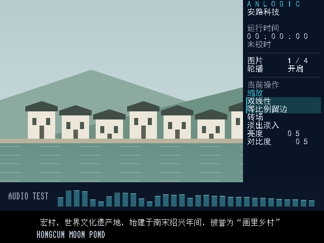

# V1.7 四区域UI：板测通过（2026-11-03）

**BOARD PASS（用户反馈）**。用户原话：“板上测试通过，github归档”。基于本地 `zoom_animation_per_image_captions`，集成480×360主图、160×360右栏、底部常驻PCM频谱和独立不透明双语字幕。

- [布局及使用](docs/UI_LAYOUT.md) · [板测记录](docs/UI_BOARD_PASS_20261103.md)
- [版本与bit哈希](versions.json) · [实现与仿真摘要](ui_evidence/release_summary.json)
- [归档文件清单](archive_manifest.json)

预览主图是测试台图案，不是实拍板端截图。右栏顺序为ANLOGIC/安路科技文字Logo、运行时间/未校时、图片编号、轮播、当前操作、缩放、转场、亮度/对比度。短中文字幕居中静止，超长字幕停留60帧再滚动；英文固定。

K1复位、K2切图、K3调参、K4轮播沿用。音频频谱常驻，1001不再切布局；1100切字幕语言。时钟为上电运行计时，非RTC真实日期。音源仍为既有内部测试音阶，没有增加TF音频解码。

## 验证与边界

12帧BMP装载逐像素比对、4帧双线性缓存缩放、8种转场、四图四语言字幕、运行时钟及I2S→FFT→OSD→AXIS集成仿真通过。中文字幕和右栏字库的BRAM初始化合计65536位已对综合网表核实。

约束内 routed setup **+0.107ns**、hold **+0.003ns**，STA覆盖95.22%。DSP 29/29；原SDRAM时钟例外及接口约束边界保留，不声称完整接口电气时序验证。用户未提供独立设备端下载哈希。

## 恢复与复现

GitHub沿用仓库惯例，只归档自研RTL、约束、文档、测试及摘要；厂商加密/生成IP、TD数据库、bit及完整工程保留本地快照。**本包不能单独生成整机bit。** 在合法取得的原厂工程中核对`ui_evidence/source_manifest.json`并按`src`相对路径恢复；工程源清单未增加条目，`ui_sidebar`定义在`osd_overlay.v`内。

纯RTL显示/缩放测试可在`ui_evidence`目录按UI_LAYOUT中的ModelSim命令运行，不需要厂商IP。字库初始化网表检查需要本地完整TD综合网表。

MIT ASCII字库来源及许可见仓库根目录`THIRD_PARTY_NOTICES.md`和`LICENSE.FPGA-text-overlay`；中文/侧栏点阵沿用本地字体生成，字体文件不上传。V1.5及历史归档保持原样。
